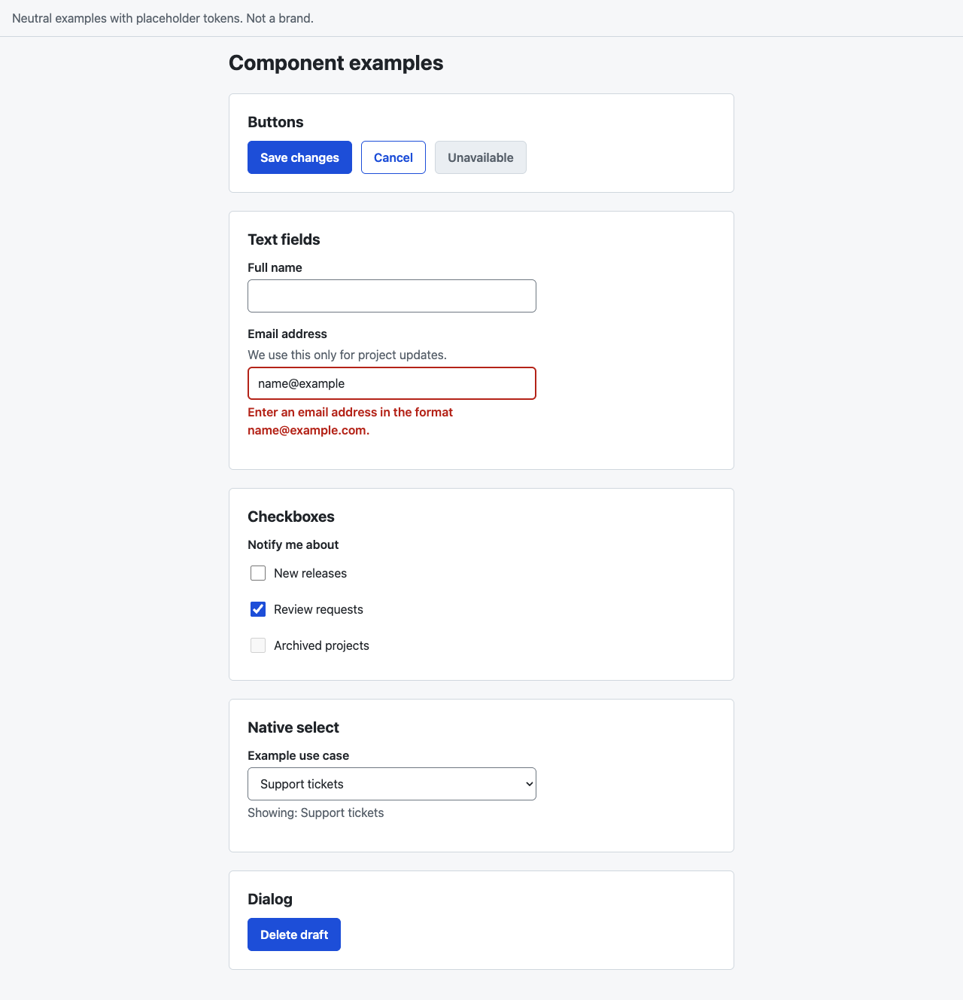

# UI/UX delivery and testing kit (draft)

A small kit for planning, building and checking interface components on real projects: project templates, a testing starter for static HTML and for React with Storybook, and neutral visual examples. It uses Storybook, Playwright, axe and, optionally, Chromatic through their official packages and documentation, and does not bundle them.

Read [STATUS.md](STATUS.md) before relying on anything here. Nothing in this folder has yet been shown to work unchanged on another project.

## Contents



This is a preview of draft neutral examples. To interact with them, run the examples locally as described below.

| Path | Use |
| --- | --- |
| [framework.md](framework.md) | Process record from the reference project, kept word for word with labelled annotations |
| [templates/](templates/) | Brief, design system, component spec, screen spec, review and handoff |
| [testing/](testing/) | Testing starter: static check, React stories, results and human review checklists |
| [examples/](examples/) | Placeholder tokens, shared CSS, a static HTML component page and React stories |
| `package.json`, `vite.config.ts`, `tsconfig.json`, `.storybook/` | Local setup for the examples and checks |
| [STATUS.md](STATUS.md) | What has and has not been verified |
| [LICENSE](LICENSE) | MIT license for this folder |

## Use it on a project

1. Fill [templates/01-project-brief.md](templates/01-project-brief.md), including stack, supported browsers and assistive technology.
2. Record project rules and the single token source in [templates/02-design-system.md](templates/02-design-system.md). Replace `examples/tokens.example.css` with the project's own values; the examples are not a brand.
3. Choose the route that matches the real site:
   * Static HTML: build a fixture from the real component and adapt `testing/static/check-static-button.mjs`. See [testing/README.md](testing/README.md), including the `ui-tests/` setup for sites without Node.
   * React with Storybook: adapt `testing/react/Button.example.stories.tsx` in the project's own Storybook.
4. Show that each new check can fail, save the evidence, and complete [testing/results-checklist.md](testing/results-checklist.md).
5. Before handoff, complete the required lines of [testing/human-review-checklist.md](testing/human-review-checklist.md) and [templates/05-review-handoff.md](templates/05-review-handoff.md).

## Run the examples locally

Requires Node 20.19 or later.

```sh
cd docs/ui-ux-delivery
npm install
npx playwright install chromium
```

* Static examples: open `examples/static/components.html` in a browser.
* React examples: `npm run storybook`, then open http://localhost:6006.
* Story tests with accessibility rules: `npm run test:stories`
* Static check: `npm run check:static` (writes JSON to `evidence/`)
* Type check: `npm run typecheck`

Set `CHROME_PATH` to use an installed Chrome instead of the Playwright browser.

## Official documentation

* Storybook accessibility tests: https://storybook.js.org/docs/writing-tests/accessibility-testing
* Storybook Vitest addon: https://storybook.js.org/docs/writing-tests/integrations/vitest-addon
* Playwright: https://playwright.dev/docs/intro
* Playwright accessibility testing with axe: https://playwright.dev/docs/accessibility-testing
* axe core rules: https://github.com/dequelabs/axe-core
* Chromatic: https://www.chromatic.com/docs/
* WCAG 2.2: https://www.w3.org/TR/WCAG22/
* ARIA Authoring Practices: https://www.w3.org/WAI/ARIA/apg/

## Related

* [UI/UX and social previews](../ui-ux-and-social-previews.md)

## Licence

This folder is licensed under MIT. Copyright © 2026 AI Spanda. Dependencies retain their own licenses; see [LICENSE](LICENSE).

> **Rights update:** The owner confirmed the included asset was created by AI Spanda. The MIT license in this folder applies to that asset. Dependencies such as Playwright and axe are installed separately and retain their own licenses; see their package notices.
