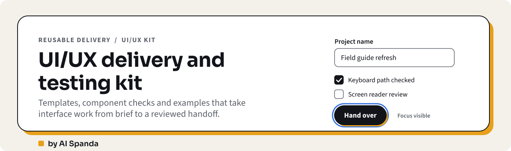
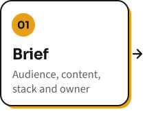
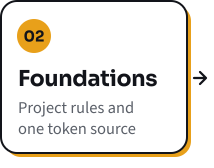
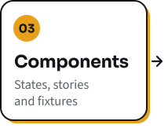
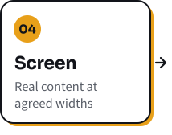
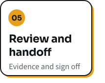

<picture>
  <source media="(prefers-color-scheme: dark)" srcset="assets/banner-dark.svg">
  <source media="(prefers-color-scheme: light)" srcset="assets/banner-light.svg">
  
</picture>

<p>
  <a href="STATUS.md"></a>
  <a href="STATUS.md#verified-in-this-package"></a>
  <a href="STATUS.md#open"></a>
  <a href="STATUS.md#open"></a>
  <a href="LICENSE"></a>
</p>

## The problem

AI tools can now produce screens in minutes, so interface work often looks finished before anyone has checked it. Error and empty states go missing, keyboard users get stuck on a control nobody tried to reach, a screenshot of one state stands in for testing, and a passing test run gets mistaken for design approval. When the work moves between tools and agents, the reasons behind each decision are usually lost on the way.

## How this kit helps

It gives each stage of the work a template, so the brief, the design rules and the component states are written down before anything is built. It gives each component a check that has been shown to fail before anyone relies on it passing. It asks every review to record who or what performed it, so a reviewer can see what was proven by a tool, what was judged by a person, and what still needs one.

## The vision

One person working with AI agents should be able to deliver professional interface work on any stack, with evidence a reviewer can inspect and rerun, and with people spending their time on the decisions that need judgment.

## Five stages

<p>
  <a href="templates/01-project-brief.md"><picture><source media="(prefers-color-scheme: dark)" srcset="assets/stage-1-dark.svg"></picture></a>
  <a href="templates/02-design-system.md"><picture><source media="(prefers-color-scheme: dark)" srcset="assets/stage-2-dark.svg"></picture></a>
  <a href="templates/03-component-spec.md"><picture><source media="(prefers-color-scheme: dark)" srcset="assets/stage-3-dark.svg"></picture></a>
  <a href="templates/04-screen-spec.md"><picture><source media="(prefers-color-scheme: dark)" srcset="assets/stage-4-dark.svg"></picture></a>
  <a href="templates/05-review-handoff.md"><picture><source media="(prefers-color-scheme: dark)" srcset="assets/stage-5-dark.svg"></picture></a>
</p>

Each tile opens its template. [framework.md](framework.md) explains the process, the evidence rules and how work passes between tools.

## Start here

| Path | First step |
| --- | --- |
| **Start a project** | Fill the [project brief](templates/01-project-brief.md), then follow [Use it on a project](#use-it-on-a-project). |
| **Test components** | Pick the static HTML or React route in the [testing starter](testing/README.md). |
| **See the examples** | Open the [showroom](showroom/index.html), the kit's front page built and checked with the kit itself, or run the examples as shown in [Run the examples locally](#run-the-examples-locally). |


The examples use placeholder tokens on purpose, so a project that adopts the kit replaces them with its own brand. This image is a preview, not a visual baseline.

The [showroom](showroom/index.html) lets you try these components with a keyboard and switch their token source live. Its [delivery record](showroom/delivery/README.md) shows the brief, design system, specs and check results behind it. It will be published at https://aispanda.github.io/Reusable-Delivery/showroom/ once GitHub Pages is enabled; until then, serve this folder with any static server and open `/showroom/`.

## Status

[STATUS.md](STATUS.md) is the record of what has and has not been verified. The checks pass inside this package. The kit has not yet been shown to work unchanged on a second project, and no human design, keyboard or screen reader review has been recorded. The showroom passes its own 33 checks, and each was also shown to fail when its feature was broken on purpose.

<details>
<summary><strong>What is in this folder</strong></summary>

| Path | Use |
| --- | --- |
| [framework.md](framework.md) | The five stage delivery process, evidence rules and tool handovers |
| [templates/](templates/) | Brief, design system, component spec, screen spec, review and handoff |
| [testing/](testing/) | Testing starter: static check, React stories, results and human review checklists |
| [examples/](examples/) | Placeholder tokens, shared CSS, a static HTML component page and React stories |
| [assets/](assets/) | README banner, stage tiles and status badges |
| [showroom/](showroom/) | One page showroom in the AI Spanda style, its checks (`npm run check:showroom`) and its delivery record |
| `package.json`, `vite.config.ts`, `tsconfig.json`, `.storybook/` | Local setup for the examples and checks |
| [STATUS.md](STATUS.md) | What has and has not been verified |
| [LICENSE](LICENSE) | MIT license for this folder |

</details>

## Use it on a project

1. Fill [templates/01-project-brief.md](templates/01-project-brief.md), including stack, supported browsers and assistive technology. Record the existing site's source version, content and qualities, or the references you will adopt or adapt, before rebuilding.
2. Record project rules and the single token source in [templates/02-design-system.md](templates/02-design-system.md). Replace `examples/tokens.example.css` with the project's own values; the examples are not a brand.
3. Choose the route that matches the real site:
   * Static HTML: build a fixture from the real component and adapt `testing/static/check-static-button.mjs`. See [testing/README.md](testing/README.md), including the `ui-tests/` setup for sites without Node.
   * React with Storybook: adapt `testing/react/Button.example.stories.tsx` in the project's own Storybook.
   * Other stacks: use a native Storybook adapter where one exists, or test built pages with the project's own runner. Confirm stories render in a browser, not only that the build exits cleanly.
4. Compare existing and candidate screens with the same content, states and widths. Show that each new check can fail, save the evidence, and complete [testing/results-checklist.md](testing/results-checklist.md).
5. Before handoff, complete the required lines of [testing/human-review-checklist.md](testing/human-review-checklist.md) and [templates/05-review-handoff.md](templates/05-review-handoff.md).

## Run the examples locally

Requires Node 20.19 or later.

```sh
cd docs/ui-ux-delivery
npm install
npx playwright install chromium
```

* Static examples: open `examples/static/components.html` in a browser.
* React examples: `npm run storybook`, then open http://localhost:6006.
* Story tests with accessibility rules: `npm run test:stories`
* Static check: `npm run check:static` (writes JSON to `evidence/`)
* Type check: `npm run typecheck`
* Showroom checks: `npm run check:showroom` (writes JSON to `showroom/delivery/check-results/`)

Set `CHROME_PATH` to use an installed Chrome instead of the Playwright browser.

## Official documentation

* Storybook accessibility tests: https://storybook.js.org/docs/writing-tests/accessibility-testing
* Storybook Vitest addon: https://storybook.js.org/docs/writing-tests/integrations/vitest-addon
* Playwright: https://playwright.dev/docs/intro
* Playwright accessibility testing with axe: https://playwright.dev/docs/accessibility-testing
* axe core rules: https://github.com/dequelabs/axe-core
* Chromatic: https://www.chromatic.com/docs/
* WCAG 2.2: https://www.w3.org/TR/WCAG22/
* ARIA Authoring Practices: https://www.w3.org/WAI/ARIA/apg/

## Related

* [UI/UX and social previews](../ui-ux-and-social-previews.md)

## Licence

This folder is licensed under MIT. Copyright © 2026 AI Spanda. Dependencies retain their own licenses; see [LICENSE](LICENSE).

The MIT license applies to the files in this folder, which AI Spanda created. Dependencies such as Storybook, Playwright and axe are installed separately and keep their own licenses; see their package notices.

The banner, stage tiles, badges and showroom carry the AI Spanda style, and the logo is the existing AI Spanda raster lockup, unchanged. The tokens and examples stay neutral, so a project that adopts this kit does not inherit the AI Spanda brand.
